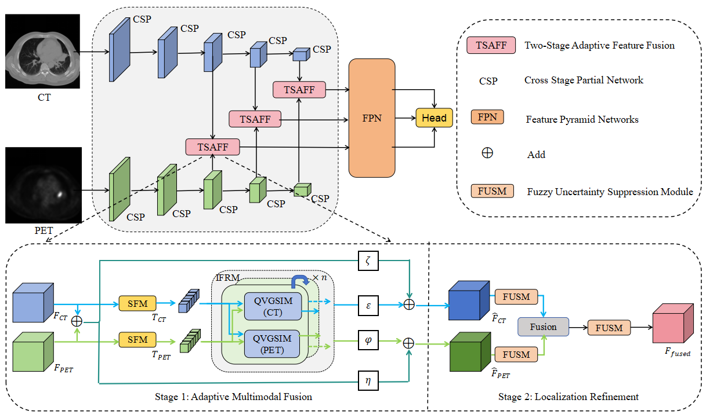

# CFR-Net

CFR-Net是一种用于配对CT和PET图像病灶检测的跨模态特征校准与细化网络。模型使用两个独立分支提取CT与PET特征，通过TSAFF模块在多个尺度上完成跨模态对齐和融合，最后由特征金字塔与YOLOX检测头输出病灶位置。

## 网络结构



TSAFF包含两个处理阶段。第一阶段进行空间特征压缩和迭代式Q-V门控跨模态交互；第二阶段利用模糊不确定性抑制机制细化空间响应，从而改善病灶定位。

模型结构与代码模块的对应关系见[架构说明](docs/architecture.md)。

## 安装

```bash
git clone https://github.com/<your-account>/CFR-PETCT.git
cd CFR-PETCT
python -m venv .venv
pip install -r requirements.txt
```

请根据本机CUDA版本安装对应的PyTorch版本。

## 数据目录

```text
data/
├── classes.txt
├── Annotations/
├── JPEGImages_CT/
├── JPEGImages_PET/
└── ImageSets/Main/
    ├── 2007_train.txt
    └── 2007_val.txt
```

临床数据不应提交到Git仓库。可以使用`DATA_ROOT`、`CLASSES_PATH`、`MODEL_PATH`、`TRAIN_LIST`、`VAL_LIST`和`SAVE_DIR`环境变量配置路径。

## 模型检查

```bash
python check_tsaff.py --phi l --loops 2 --size 640
```

## 训练

```bash
python train_tsaff.py
```

## 测试

```bash
python test_tsaff.py \
  --checkpoint ./weights/best_epoch_weights.pth \
  --val-list ./data/ImageSets/Main/2007_val.txt \
  --classes ./data/classes.txt
```

## 引用

如果本项目对您的研究有帮助，请引用对应论文。论文正式发表后可在此补充BibTeX信息。

